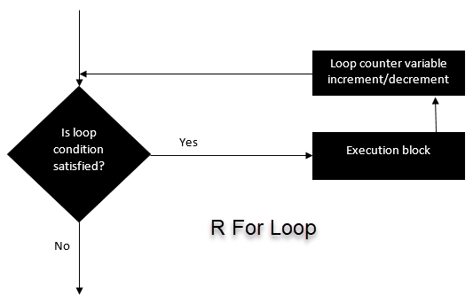



::: {.lesson-meta}
[Livello 1 · Fondamenti]{.level-1} [⏱ ~60 min]{} [Prerequisiti: [Vettori](../01-foundations/04-vectors.qmd), [Liste](../01-foundations/07-lists.qmd), [Istruzioni condizionali: if, else e dintorni](15-conditionals.qmd)]{}
:::

::: {.callout-note .objectives}
## Obiettivi di apprendimento

Al termine di questa lezione sarai in grado di:

- scrivere cicli `for` su vettori, liste e matrici usando `seq_along()` e `seq_len()`;
- **preallocare** l'oggetto che conserva i risultati, e spiegare perché è più veloce;
- scrivere cicli `while` e `repeat` con una regola di arresto chiara e garantita;
- usare `next` e `break` per saltare iterazioni o uscire prima da un ciclo;
- decidere quando un ciclo è lo strumento giusto e quando il codice **vettorizzato** è più semplice e veloce.
:::

```{r}
#| label: setup
#| include: false
source(here::here("_common.R"))
```

```{r}
#| label: packages
library(ggplot2)
```

## 1. Perché i cicli?

Molti compiti consistono nel fare **la stessa cosa molte volte**: leggere 20 file, stimare un modello per ciascuna di 3 specie, simulare 1,000 esperimenti casuali, aggiornare un saldo bancario mese dopo mese. Scrivere la stessa riga 1,000 volte non è un'opzione. Un **ciclo** (*loop*) ripete un blocco di codice cambiando una cosa (la *variabile del ciclo*) a ogni ripetizione, detta **iterazione**.

R ha tre tipi di ciclo:

| Ciclo | Ripete… | Uso tipico |
|---|---|---|
| `for` | una volta per **ogni elemento** di una sequenza | numero di iterazioni noto |
| `while` | **finché** una condizione è `TRUE` | numero di iterazioni non noto |
| `repeat` | **per sempre**, finché non chiami `break` | regola di arresto verificata a metà del blocco |

## 2. Il ciclo `for`

```{r}
#| label: for-syntax
#| eval: false
for (element in sequence) {
  # codice che usa `element`
}
```

{fig-align="center" width="70%"}

La variabile del ciclo assume a turno ciascun valore della sequenza:

```{r}
#| label: for-fruit
fruit <- c("Mela", "Arancia", "Frutto della passione", "Banana")

for (f in fruit) {
  cat("Mi piace:", f, "\n")
}
```

`cat()` stampa i suoi argomenti separati da spazi; `"\n"` va a capo. Dentro un ciclo i valori **non** vengono stampati automaticamente: usa `cat()` o `print()` se vuoi vederli.

### Iterare sulle posizioni con `seq_along()`

Spesso ti serve la **posizione** `i` invece del valore, per esempio per salvare i risultati. Usa `seq_along(x)`, che restituisce `1, 2, …, length(x)`:

```{r}
#| label: for-seq-along
for (i in seq_along(fruit)) {
  cat(i, ":", fruit[i], "\n")
}
```

Perché non `1:length(x)`? Perché fallisce quando `x` è vuoto:

```{r}
#| label: one-to-length
empty <- character(0)
1:length(empty)        # c(1, 0): il ciclo girerebbe due volte sul nulla!
seq_along(empty)       # integer(0): il ciclo, correttamente, gira zero volte
```

Allo stesso modo, `seq_len(n)` restituisce `1, …, n` e, correttamente, non restituisce nulla quando `n` è 0.

## 3. Salvare i risultati: prealloca

La maggior parte dei cicli calcola a ogni iterazione qualcosa che vuoi conservare. Lo schema corretto ha tre passi:

1. **crea** un contenitore vuoto della lunghezza giusta *prima* del ciclo;
2. **riempi** la posizione `i` dentro il ciclo;
3. usa il contenitore dopo il ciclo.

```{r}
#| label: prealloc
n <- 10
squares <- numeric(n)          # 1. dieci zeri
for (i in seq_len(n)) {
  squares[i] <- i^2            # 2. riempi la posizione i
}
squares                        # 3. usalo
```

Per risultati che non sono singoli numeri (vettori di lunghezze diverse, data frame, modelli) crea una **lista** con `vector("list", n)` e riempila con `[[i]]`:

```{r}
#| label: prealloc-list
out <- vector("list", length = 3)
for (i in seq_along(out)) {
  out[[i]] <- seq_len(i)
}
str(out)
```

::: {.callout-tip}
## Non chiamare la tua lista `list`
Una variabile chiamata `list` (o `c`, `mean`, `data`) nasconde la funzione predefinita con lo stesso nome e rende il codice confuso. Usa nomi come `out`, `results`, `fits`.
:::

### Perché preallocare? Un esperimento di cronometraggio

L'alternativa allettante è partire da un vettore vuoto e **farlo crescere** con `c()` a ogni passo. Misuriamo tre approcci per 20,000 quadrati con `system.time()`, che riporta quanto tempo richiede un pezzo di codice (la colonna `elapsed` è il tempo reale trascorso, in secondi):

```{r}
#| label: timing
n <- 20000

t_grow <- system.time({
  x <- c()
  for (i in seq_len(n)) x <- c(x, i^2)      # cresce a ogni passo
})
t_pre <- system.time({
  y <- numeric(n)
  for (i in seq_len(n)) y[i] <- i^2         # preallocato
})
t_vec <- system.time(z <- seq_len(n)^2)     # vettorizzato, senza ciclo

c(grow = t_grow[["elapsed"]], prealloc = t_pre[["elapsed"]],
  vectorised = t_vec[["elapsed"]])
```

::: {.callout-tip .read-output}
## Come leggere questo output
I tre numeri sono secondi (cambiano un po' da un'esecuzione all'altra e da un computer all'altro). Far crescere il vettore è di gran lunga l'approccio più lento: a ogni iterazione `c(x, i^2)` **copia l'intero vettore** in uno nuovo, quindi il lavoro totale cresce con il *quadrato* di `n`. Riempire un vettore preallocato richiede una quantità di lavoro costante a ogni passo. La versione vettorizzata, `seq_len(n)^2`, esegue il ciclo internamente in codice C compilato ed è la più veloce di tutte.
:::

## 4. Iterare su liste, matrici e data frame

### Liste

La variabile del ciclo riceve ciascun **elemento** della lista:

```{r}
#| label: loop-list
basket <- list(
  fruit    = c("Mela", "Arancia", "Banana"),
  prices   = c(1.2, 0.8, 0.5),
  paid     = FALSE
)

for (item in basket) {
  print(item)
}
```

Quando ti servono anche i nomi, itera su `names()` ed estrai con `[[`:

```{r}
#| label: loop-list-names
for (nm in names(basket)) {
  cat(nm, "ha", length(basket[[nm]]), "elemento/i\n")
}
```

### Matrici: righe e colonne

Una matrice ha due dimensioni, quindi un ciclo **annidato** (un ciclo dentro un ciclo) visita ogni cella:

```{r}
#| label: loop-matrix
mat <- matrix(10:15, nrow = 3, ncol = 2)

for (r in seq_len(nrow(mat))) {
  for (c in seq_len(ncol(mat))) {
    cat("Riga", r, "colonna", c, "ha valore", mat[r, c], "\n")
  }
}
```

Per calcolare qualcosa **per riga** (o per colonna) basta un solo ciclo sulle righe:

```{r}
#| label: loop-rows
row_max <- numeric(nrow(mat))
for (r in seq_len(nrow(mat))) {
  row_max[r] <- max(mat[r, ])
}
row_max
```

### Colonne di un data frame

Un data frame è una lista di colonne, quindi iterare su di esso significa visitarne le colonne:

```{r}
#| label: loop-df
num_cols <- penguins[, c("bill_len", "bill_dep", "flipper_len", "body_mass")]
col_means <- numeric(ncol(num_cols))
names(col_means) <- names(num_cols)

for (j in seq_along(num_cols)) {
  col_means[j] <- mean(num_cols[[j]], na.rm = TRUE)
}
round(col_means, 1)
```

È un'operazione così frequente che R offre strumenti più brevi (`colMeans()`, `sapply()`, `purrr::map()`, `across()`): vedi [Iterazione](17-iteration.qmd).

## 5. Il ciclo `while`

Un ciclo `while` ripete il suo blocco **finché** una condizione è `TRUE`. È la scelta giusta quando non sai in anticipo quante iterazioni serviranno.

```{r}
#| label: while-syntax
#| eval: false
while (condition) {
  # codice che prima o poi deve rendere `condition` FALSE
}
```

```{r}
#| label: while-count
i <- 1
while (i <= 5) {
  cat("Questo è il giro numero", i, "\n")
  i <- i + 1                   # senza questa riga il ciclo non finisce mai
}
```

La condizione viene controllata **prima** di ogni iterazione. Se nulla dentro il ciclo la rende prima o poi `FALSE`, il ciclo gira **per sempre** (premi *Esc* o il pulsante di stop per interromperlo).

### Esempio: simulare il prezzo di un'azione

Un'azione parte da 50. Ogni giorno il suo prezzo cambia di un importo intero casuale tra −10 e +10. Vendiamo non appena il prezzo scende a 45 o meno (*stop loss*) oppure sale a 70 o più (*take profit*). Per quanti giorni teniamo l'azione?

Non possiamo conoscere in anticipo il numero di giorni, quindi `while` è la scelta naturale. Come rete di sicurezza, ci fermiamo comunque dopo al massimo 1,000 giorni.

```{r}
#| label: stock-while
set.seed(123)

price    <- 50
day      <- 0
max_days <- 1000
path     <- price                       # conserva tutta la storia per un grafico

while (price > 45 && price < 70 && day < max_days) {
  day   <- day + 1
  price <- price + sample(-10:10, size = 1)
  path  <- c(path, price)
}

c(days = day, final_price = price)
```

Il ciclo si è fermato dopo `r day` giorni con un prezzo di `r price`. (Qui far crescere `path` con `c()` va bene: il ciclo è breve e non conosciamo in anticipo la sua lunghezza finale.)

```{r}
#| label: fig-stock
#| fig-cap: "Un percorso di prezzo simulato. Le linee tratteggiate sono le due regole di arresto; il ciclo termina la prima volta che il prezzo ne attraversa una."
ggplot(data.frame(day = seq_along(path) - 1, price = path),
       aes(day, price)) +
  geom_hline(yintercept = c(45, 70), linetype = "dashed", colour = "grey50") +
  geom_line(linewidth = 0.8) +
  geom_point() +
  labs(x = "Giorno", y = "Prezzo",
       title = "Una passeggiata aleatoria fermata da stop loss o take profit")
```

Ogni volta che cambi il seme ottieni un percorso diverso e un numero di giorni diverso. Ripetere la simulazione molte volte (con un ciclo `for` attorno al ciclo `while`!) ti dà la *distribuzione* del tempo di detenzione: è l'idea alla base della [simulazione](../07-probability/28-randomness-simulation.qmd).

::: {.callout-note .deeper collapse="true"}
## Per approfondire: perché un numero massimo di iterazioni?
Questa passeggiata dei prezzi parte a metà dell'intervallo (45, 70) e si muove fino a 10 al giorno, quindi in pratica esce sempre rapidamente dall'intervallo. Ma la regola di arresto di un ciclo non dovrebbe dipendere dalla fortuna o da parametri che qualcuno potrebbe modificare in seguito (per esempio un passo pari a 0 o limiti irraggiungibili). Un tetto come `day < max_days`, più un controllo dopo il ciclo (`if (day == max_days) warning(...)`), garantisce che il codice termini e ti avvisa quando si è fermato per il motivo "sbagliato". Gli algoritmi iterativi in statistica (per esempio quelli che stimano la [regressione logistica](../09-regression/41-logistic-regression.qmd)) usano esattamente questo schema: iterare fino a convergenza *oppure* fino a un numero massimo di iterazioni.
:::

## 6. `repeat`, `break` e `next`

### `repeat` + `break`

`repeat` gira per sempre finché non incontra `break`. È utile quando il test di arresto si colloca naturalmente **a metà** o **alla fine** del blocco, per esempio "lancia un dado finché non esce un sei":

```{r}
#| label: repeat
set.seed(2)
rolls <- 0
repeat {
  roll  <- sample(1:6, size = 1)
  rolls <- rolls + 1
  if (roll == 6) break           # esci dal ciclo
}
rolls
```

`break` funziona anche dentro `for` e `while`: esce immediatamente dal ciclo più interno.

### `next`: passa all'iterazione successiva

`next` abbandona l'iterazione corrente e passa a quella successiva. È comodo per saltare input inutilizzabili:

```{r}
#| label: next
values <- c(4, NA, 9, -1, 16)
roots  <- rep(NA_real_, length(values))

for (i in seq_along(values)) {
  if (is.na(values[i]) || values[i] < 0) next   # salta mancanti / negativi
  roots[i] <- sqrt(values[i])
}
roots
```

## 7. Cicli o vettorizzazione? {#loops-or-vectorisation}

Molte operazioni in R sono **vettorizzate**: lavorano su un intero vettore in un colpo solo (`x^2`, `x + y`, `sum(x)`, `cumsum(x)`, `ifelse()`…). Quando esiste una versione vettorizzata, di solito è più breve, più leggibile e più veloce:

```{r}
#| label: vectorised
x <- c(3, 8, 1, 9)

# versione con ciclo
total <- 0
for (v in x) total <- total + v^2
total

# versione vettorizzata
sum(x^2)
```

**I cicli vanno benissimo** (e sono spesso la scelta più chiara) quando

- ogni passo **dipende dal precedente** (il prezzo dell'azione, un saldo bancario con interessi, un algoritmo iterativo);
- ogni iterazione svolge un **compito corposo** (leggere un file, stimare un modello, produrre un grafico), così il costo aggiuntivo del ciclo è trascurabile;
- il numero di iterazioni **non è noto** (`while`, `repeat`).

**Preferisci il codice vettorizzato** quando la stessa operazione semplice si applica a ogni elemento in modo indipendente. A metà strada ci sono le funzioni di iterazione `lapply()`, `sapply()` e `purrr::map()`, che nascondono la contabilità di un ciclo `for`: vedi [Iterazione](17-iteration.qmd).

::: {.callout-warning .pitfall}
## Errori comuni

1. **`1:length(x)` su un `x` vuoto** dà `c(1, 0)` e fa girare il ciclo due volte. Usa `seq_along(x)` / `seq_len(n)`.
2. **Far crescere un risultato con `c()` o `rbind()` in un ciclo lungo** è molto lento. Prealloca con `numeric(n)` o `vector("list", n)`; per i data frame, salva i pezzi in una lista e combinali una sola volta alla fine (`do.call(rbind, pieces)` o `purrr::list_rbind()`).
3. **Sovrascrivere invece di salvare.** `for (i in 1:10) res <- i^2` conserva solo l'ultimo valore. Scrivi `res[i] <- i^2`.
4. **Un ciclo `while` che non finisce mai**, perché la variabile del ciclo non viene mai aggiornata o la condizione non può mai diventare `FALSE`. Aggiungi sempre un numero massimo di iterazioni.
5. **Aspettarsi che i valori vengano stampati dentro un ciclo.** La stampa automatica non avviene dentro i cicli (né dentro le funzioni): usa `print()` o `cat()`.
6. **Usare `[` invece di `[[` su una lista** dentro un ciclo: `out[i] <- list(...)` contro `out[[i]] <- value`. Con `[[` salvi l'oggetto stesso.
:::

## 8. Verifica la comprensione

::: {.callout-note collapse="true" icon="false"}
## D1. Quante volte viene eseguito il corpo di `for (i in seq_len(0)) print(i)`?

Zero volte: `seq_len(0)` è una sequenza vuota. Con `1:0` verrebbe eseguito due volte (per `1` e per `0`).
:::

::: {.callout-note collapse="true" icon="false"}
## D2. Quanto vale `k` dopo questo codice?

```r
k <- 0
while (k < 10) k <- k + 3
```

`12`. I valori sono 0, 3, 6, 9, 12; la condizione viene controllata *prima* di ogni passo, quindi il ciclo aggiunge 3 a 9 e poi si ferma perché `12 < 10` è `FALSE`.
:::

::: {.callout-note collapse="true" icon="false"}
## D3. Vuoi la somma cumulata di un vettore numerico. Ciclo o funzione vettorizzata?

Usa `cumsum(x)`: è una funzione vettorizzata già disponibile. Scrivi un ciclo solo se una funzione del genere non esiste.
:::

## 9. Esercizi

### Interattivi (da eseguire nel browser)

::: {.exercise}
[★]{.stars} **Esercizio 1 — riempi un vettore preallocato.** Per ogni colonna di `mtcars`, salva il numero di valori **distinti** (`length(unique(x))`) in un vettore preallocato `n_distinct`, poi stampalo.

```{webr}
#| exercise: ex_16_1
n_distinct <- integer(______)
names(n_distinct) <- names(mtcars)
for (j in ______(mtcars)) {
  n_distinct[j] <- length(unique(mtcars[[______]]))
}
n_distinct
```

::: {.hint exercise="ex_16_1"}
Il contenitore ha bisogno di `ncol(mtcars)` posizioni; itera su `seq_along(mtcars)` ed estrai la colonna `j` con `mtcars[[j]]`.
:::

::: {.solution exercise="ex_16_1"}
```r
n_distinct <- integer(ncol(mtcars))
names(n_distinct) <- names(mtcars)
for (j in seq_along(mtcars)) {
  n_distinct[j] <- length(unique(mtcars[[j]]))
}
n_distinct
```
Colonne come `vs` e `am` hanno solo 2 valori distinti (sono codici binari), `cyl` ne ha 3: un indizio che andrebbero trattate come variabili categoriali, non come numeri.
:::
:::

::: {.exercise}
[★★]{.stars} **Esercizio 2 — trova il bug.** Questo ciclo dovrebbe salvare la media cumulata di `x` (la media dei primi `i` valori, per ogni `i`), ma il risultato stampato contiene un solo numero. Correggilo.

```{webr}
#| exercise: ex_16_2
x <- c(2, 4, 6, 8, 10)
for (i in seq_along(x)) {
  running <- mean(x[1:i])
}
running
```

::: {.hint exercise="ex_16_2"}
`running` viene sovrascritto a ogni iterazione. Crealo prima del ciclo con `numeric(length(x))` e salva in `running[i]`.
:::

::: {.solution exercise="ex_16_2"}
```r
x <- c(2, 4, 6, 8, 10)
running <- numeric(length(x))
for (i in seq_along(x)) {
  running[i] <- mean(x[1:i])
}
running            # 2 3 4 5 6

cumsum(x) / seq_along(x)   # l'equivalente vettorizzato
```
:::
:::

::: {.exercise}
[★★]{.stars} **Esercizio 3 — `while` con una regola di arresto.** Depositi 1,000 euro su un conto di risparmio al 3% di interesse annuo. Usa un ciclo `while` per trovare dopo quanti **anni** il saldo raggiunge per la prima volta 2,000 euro.

```{webr}
#| exercise: ex_16_3
balance <- 1000
years <- 0
while (balance < ______) {
  balance <- balance * ______
  years <- ______
}
years
balance
```

::: {.hint exercise="ex_16_3"}
Ogni anno il saldo viene moltiplicato per `1.03`, e `years` aumenta di 1.
:::

::: {.solution exercise="ex_16_3"}
```r
balance <- 1000
years <- 0
while (balance < 2000) {
  balance <- balance * 1.03
  years <- years + 1
}
years      # 24
balance    # circa 2033
```
Ogni passo dipende dal saldo precedente: un uso naturale di un ciclo. (Verifica: `log(2) / log(1.03)` vale circa 23.4, quindi il raddoppio avviene durante il 24° anno.)
:::
:::

::: {.exercise}
[★★★]{.stars} **Esercizio 4 — simula molti tempi di arresto.** Inserisci l'esperimento "lancia un dado finché non esce un sei" in un ciclo `for` che lo ripete 5,000 volte e salva ogni volta il numero di lanci. Qual è il numero medio di lanci? (La teoria dice 6.)

```{webr}
#| exercise: ex_16_4
set.seed(1)
n_sim <- 5000
n_rolls <- integer(n_sim)
for (s in seq_len(n_sim)) {
  rolls <- 0
  repeat {
    rolls <- rolls + 1
    if (sample(1:6, size = 1) == 6) ______
  }
  n_rolls[______] <- rolls
}
mean(n_rolls)
```

::: {.hint exercise="ex_16_4"}
Esci dal ciclo `repeat` con `break`, poi salva il conteggio nella posizione `s`.
:::

::: {.solution exercise="ex_16_4"}
```r
set.seed(1)
n_sim <- 5000
n_rolls <- integer(n_sim)
for (s in seq_len(n_sim)) {
  rolls <- 0
  repeat {
    rolls <- rolls + 1
    if (sample(1:6, size = 1) == 6) break
  }
  n_rolls[s] <- rolls
}
mean(n_rolls)   # vicino a 6
```
`break` esce solo dal `repeat` interno, quindi il `for` esterno prosegue con la simulazione successiva. Il numero di lanci segue una distribuzione *geometrica* con media $1/p = 6$; prova `hist(n_rolls)` per vederne la lunga coda destra.
:::
:::

### Da svolgere sul tuo computer

::: {.exercise}
[★★]{.stars} **Esercizio 5 — molte simulazioni dell'azione.** Trasforma la simulazione dell'azione della Sezione 5 in una funzione `hold_time(start = 50, low = 45, high = 70, max_days = 1000)` che restituisca il numero di giorni. Eseguila 2,000 volte (dopo un unico `set.seed()`) e riporta il tempo medio di detenzione e la proporzione di esecuzioni terminate con *take profit*. (Suggerimento: fai restituire alla funzione una lista con `days` e `outcome`.)

::: {.callout-tip collapse="true"}
## Soluzione
```r
hold_time <- function(start = 50, low = 45, high = 70, max_days = 1000) {
  price <- start
  day <- 0
  while (price > low && price < high && day < max_days) {
    day <- day + 1
    price <- price + sample(-10:10, size = 1)
  }
  outcome <- if (price >= high) "guadagno" else if (price <= low) "perdita" else "tetto"
  list(days = day, outcome = outcome)
}

set.seed(10)
n_sim <- 2000
days <- integer(n_sim)
outcome <- character(n_sim)
for (s in seq_len(n_sim)) {
  res <- hold_time()
  days[s] <- res$days
  outcome[s] <- res$outcome
}
mean(days)
prop.table(table(outcome))
```
Poiché il punto di partenza (50) è molto più vicino allo stop loss (45) che al take profit (70), la maggior parte delle esecuzioni termina in perdita, anche se le variazioni giornaliere hanno media zero.
:::
:::

## Riepilogo

| Strumento | Uso |
|---|---|
| `for (x in v)` | un'iterazione per ogni elemento di `v` |
| `seq_along(v)`, `seq_len(n)` | sequenze di posizioni sicure |
| `numeric(n)`, `character(n)`, `vector("list", n)` | preallocare i risultati |
| `while (cond)` | ripeti finché `cond` è `TRUE`; aggiungi un numero massimo di iterazioni |
| `repeat { ... if (...) break }` | test di arresto a metà del blocco |
| `next`, `break` | salta questa iterazione / esci dal ciclo |
| `system.time()` | misura il tempo di un pezzo di codice |

- Itera sulle **posizioni** con `seq_along()` e **riempi un contenitore preallocato**.
- Ogni ciclo `while`/`repeat` ha bisogno di una regola di arresto che sia **garantito** venga soddisfatta.
- I cicli sono lo strumento giusto quando i passi dipendono l'uno dall'altro o sono compiti corposi.
- Per semplici operazioni elemento per elemento, il codice **vettorizzato** è più breve e più veloce.

::: {.callout-note collapse="true" icon="false"}
## Per saperne di più

- Wickham, Çetinkaya-Rundel & Grolemund, *R for Data Science* (2a ed.), capitolo "Iteration", <https://r4ds.hadley.nz/iteration.html>
- Wickham, *Advanced R* (2a ed.), capitolo "Control flow", <https://adv-r.hadley.nz/control-flow.html>
:::
